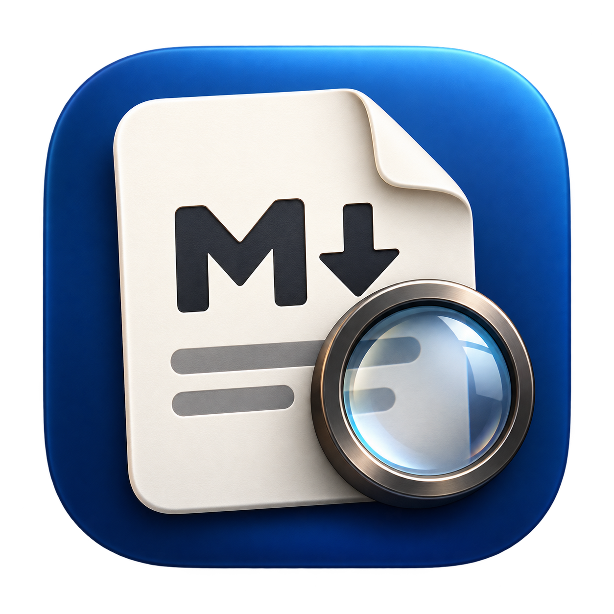

<p align="center">
  
</p>

<h1 align="center">Markoscope</h1>

<p align="center">A small, native macOS app for reading Markdown.</p>

<p align="center">Vibe-coded for personal use, but published for everyone who wants to save some time &amp; tokens.</p>

## Features

- **Nice themes**: Reader, Clean, Sepia and Night
- **Mermaid diagrams** from ` ```mermaid ` code blocks
- **Live reload**: save the file in any editor and the window updates in place
- **Change history**: every version of the file, with what changed highlighted in red and green

## Build & run

Requires macOS 13+ and the Xcode Command Line Tools.

```bash
./run.sh                  # build, then open examples/sample.md
./run.sh notes/todo.md    # build, then open a file
./run.sh --build-only     # just build build/Markoscope.app
```

The first build downloads the JavaScript libraries (marked, DOMPurify, highlight.js, Mermaid) into `Resources/web/vendor`. After that, the app works offline.

## Settings

Settings are kept in `~/.markoscope/config.toml`, and recently opened files in `~/.markoscope/history`:

```toml
theme = "reader"      # reader, clean, sepia, night
font_size = 18        # 12–32
outline_pane = false
history_pane = true
show_changes = false
merge_window = 5      # seconds; changes this close together count as one version
recent_files = 5      # files listed in the welcome window and File ▸ Open Recent
```

You can edit the file by hand. The app rewrites it whenever you change a setting, so comments you add won't be kept.

## How it works

The app is AppKit with one `WKWebView` per document window. The Swift side ([Sources/markoscope](Sources/markoscope)) handles files, windows, menus, version history and settings. The page in [Resources/web](Resources/web) turns Markdown into HTML, draws the diagrams, and highlights changes between versions ([diff.js](Resources/web/diff.js)). All theme styling lives in [style.css](Resources/web/style.css).
