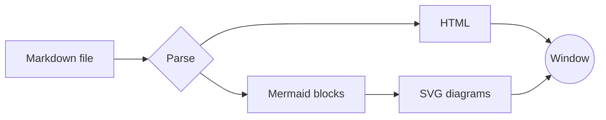
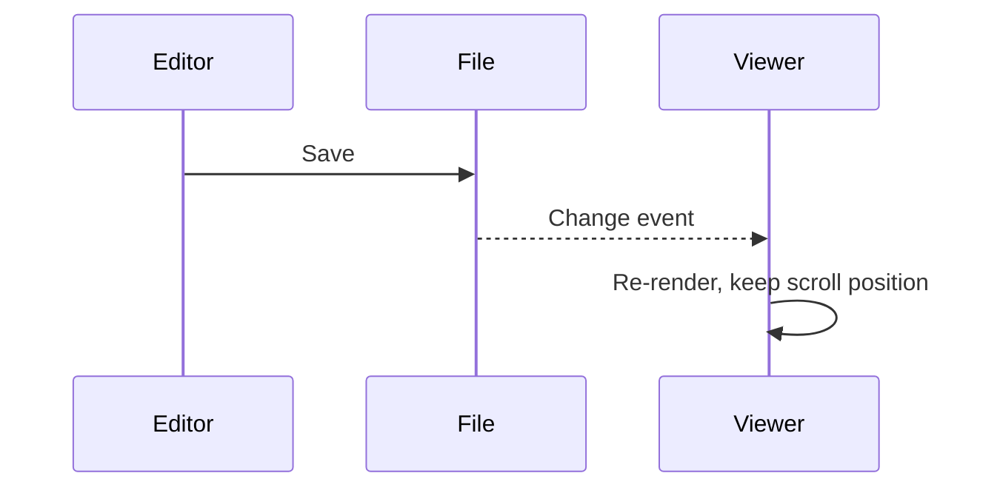
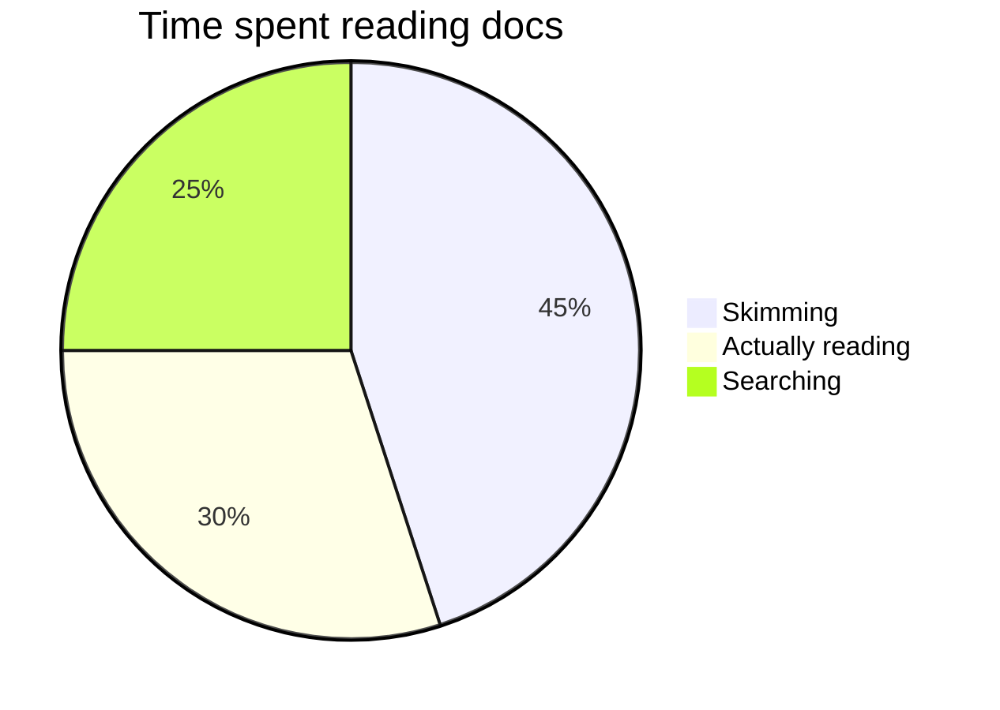

# A Comfortable Place to Read

Markoscope renders your notes with *generous spacing*, a **calm typeface**, and a line length that's easy on the eyes. Use the toolbar to switch themes or change the text size — or press **⌘+** and **⌘−**. Edit this file in any editor and the window updates live.

> Typography exists to honor content.
> — Robert Bringhurst

## Contents

- [Text and lists](#text-and-lists)
- [Code](#code)
- [Tables](#tables)
- [Diagrams](#diagrams)

## Text and lists

Paragraphs flow naturally, with `inline code`, [links](https://commonmark.org), ~~strikethrough~~, and <mark>highlighted</mark> text. Keyboard shortcuts look like <kbd>⌘</kbd> <kbd>R</kbd>.

1. Ordered lists
2. With nested items
   - like this one
   - and this one
3. Back to the top level

- [x] Task lists are supported
- [ ] So are unchecked items

---

## Code

```swift
struct Greeter {
    let name: String

    func greet() -> String {
        // Say hello
        return "Hello, \(name)!"
    }
}
```

```python
def fibonacci(n: int) -> list[int]:
    seq = [0, 1]
    while len(seq) < n:
        seq.append(seq[-1] + seq[-2])
    return seq[:n]
```

## Tables

| Theme  | Typeface | Best for              |
| ------ | -------- | --------------------- |
| Reader | Serif    | Long-form reading     |
| Clean  | Sans     | Technical docs        |
| Sepia  | Serif    | Low-contrast comfort  |
| Night  | Serif    | Dark rooms            |

## Diagrams

Mermaid code blocks render as diagrams and follow the active theme.






